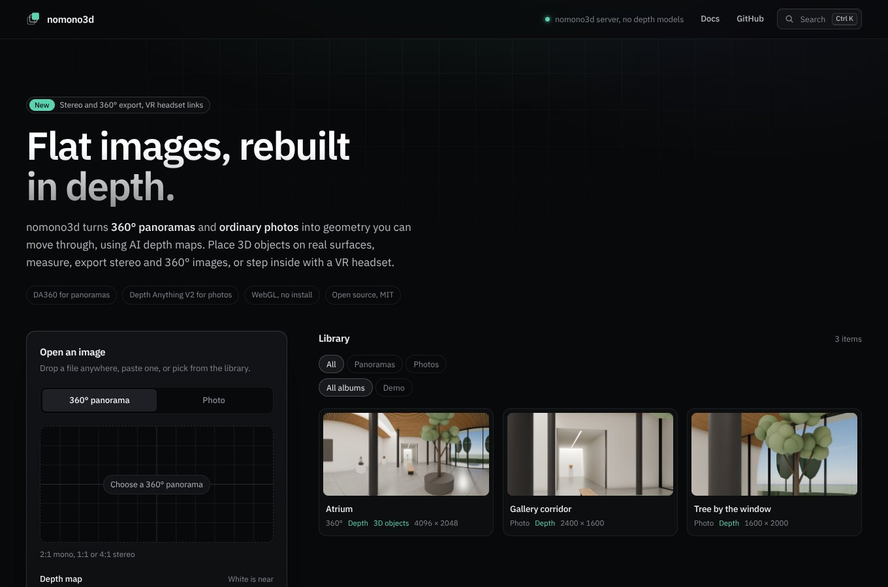
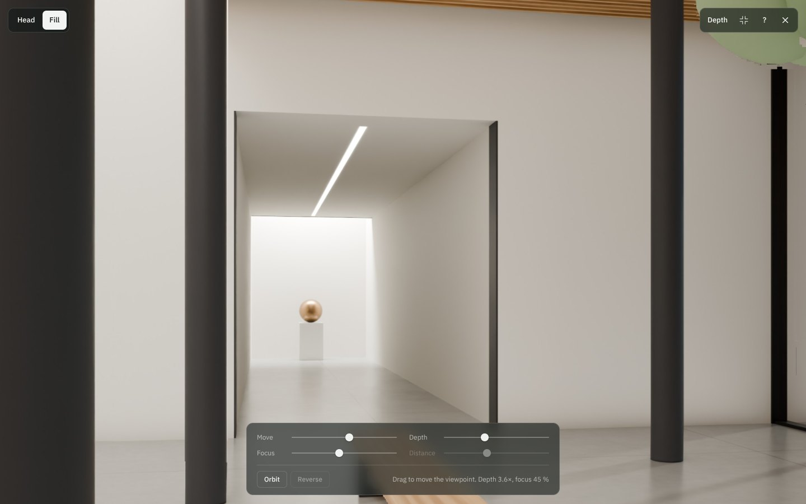
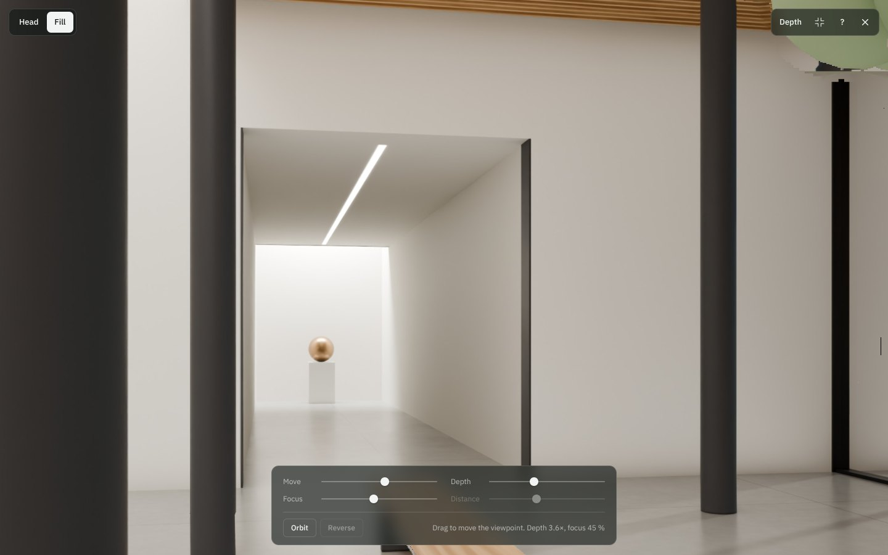
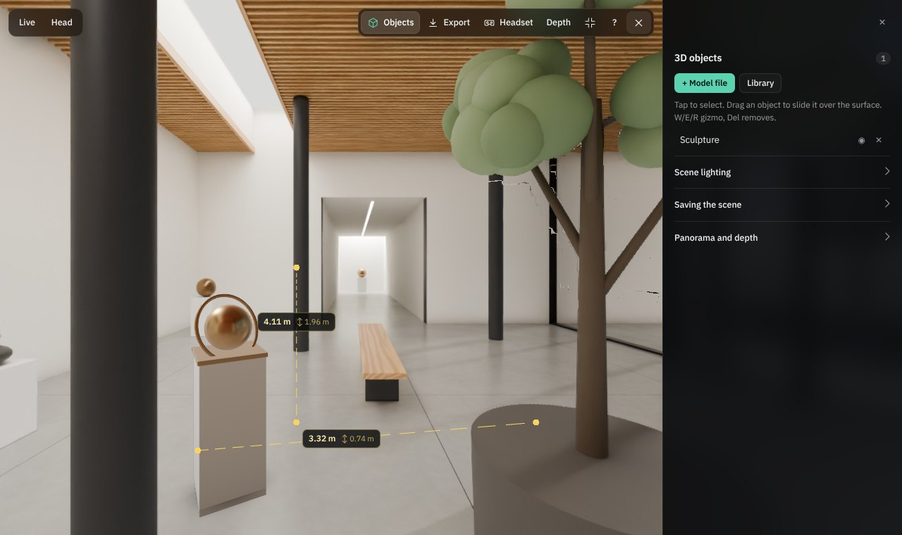
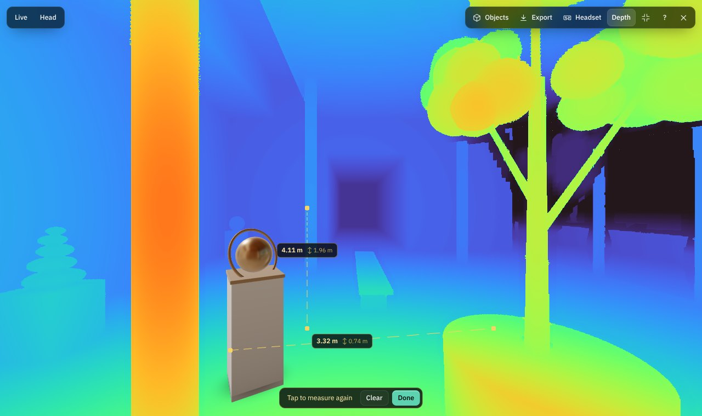
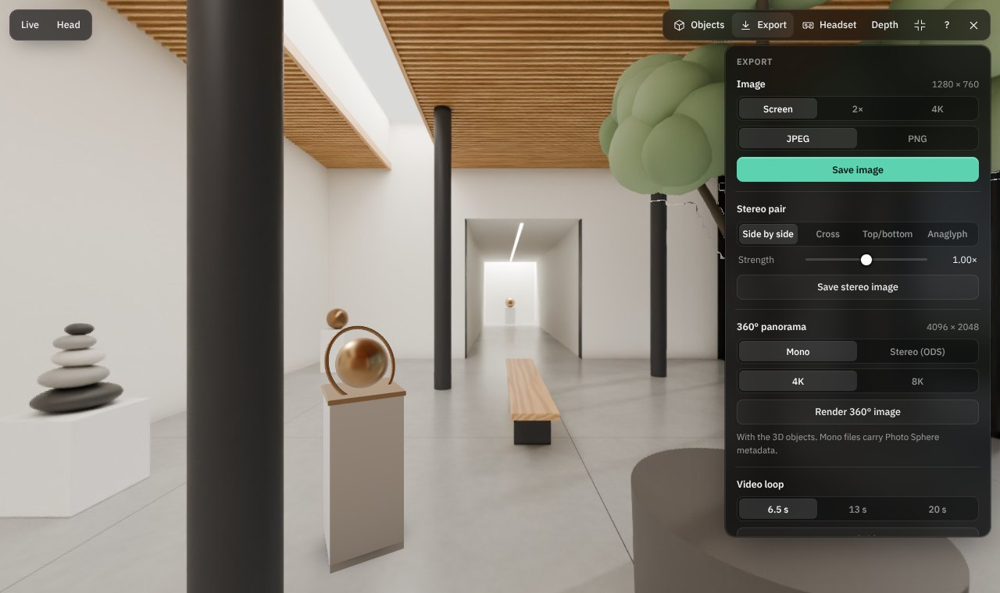
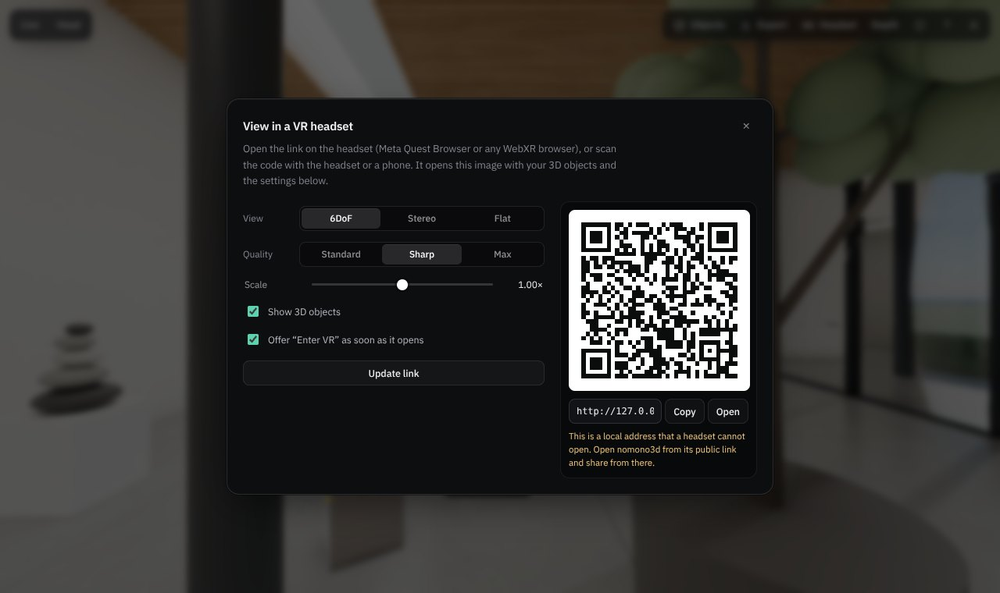
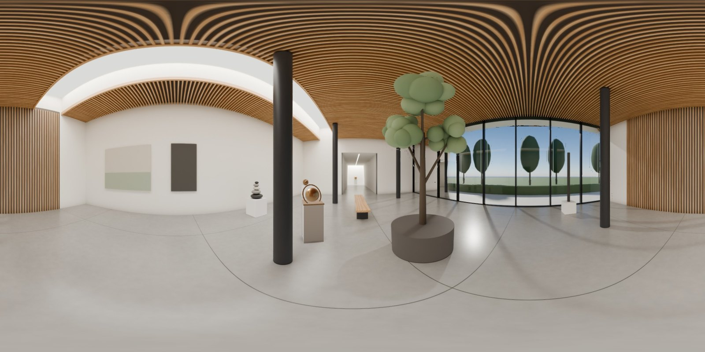

<p align="center">
  
</p>

<h1 align="center">nomono3d</h1>

<p align="center">
  Turn flat 360° panoramas and ordinary photos into explorable 3D in the browser.<br>
  An AI depth map rebuilds the image as geometry: parallax on a phone, a desktop, with head tracking or in a VR headset,<br>
  3D models standing on real depth, measuring, and stereo, 360° and video export.<br>
  <sub>AI models: <a href="https://github.com/Insta360-Research-Team/DA360">DA360</a> for 360° depth, <a href="https://github.com/DepthAnything/Depth-Anything-V2">Depth Anything V2</a> for photo depth, <a href="https://github.com/Picsart-AI-Research/MI-GAN">MI-GAN</a> for the background behind objects.</sub>
</p>

<p align="center">
  <a href="https://colab.research.google.com/github/yevheniikhan/nomono3d/blob/main/colab/nomono3d_colab.ipynb"></a>
  <a href="LICENSE"></a>
  
  
</p>

---

## What it does

| | 360° panoramas | Photos |
|---|---|---|
| **Input** | Equirectangular 2:1, or 1:1 / 4:1 stereo | Any aspect ratio |
| **Depth** | Your depth map, [DA360](https://github.com/Insta360-Research-Team/DA360) on the GPU server, or estimated from a stereo pair | Your depth map, [Depth Anything V2](https://github.com/DepthAnything/Depth-Anything-V2) on the GPU server or in the browser |
| **Viewing** | Look around and shift the viewpoint: drag, device tilt, head tracking through the front camera | A window with parallax: drag, tilt, head tracking or an automatic orbit |
| **3D objects** | Place GLB, OBJ, FBX, USDZ, PLY, LAS and more on the real surface, with occlusion, shadows and labels; slide over the surface, move freely or drop with gravity | Same, in the photo's relative space |
| **Untextured models** | Studio looks (clay, porcelain, bronze, jade), technical, toon, X-ray, normals and height styles, plus shading cues (rim light, sky and ground tint, cavities) | Same |
| **Depth views** | Grey, colour, distance contours, slice, normals and fog overlays; distance measuring in metres | Same, relative distances |
| **Export** | Image up to 4K, stereo pair (side by side, cross, top/bottom, anaglyph), 360° mono or ODS stereo with the objects, video loop | Image, stereo pair, video loop |
| **VR headset** | WebXR on Meta Quest and other headsets: 6DoF inside the depth mesh, original stereo or flat; a link and QR code carry the scene and settings | A large 3D window in true stereo |
| **Library** | Folders on any web host, albums, thumbnails, direct links | Same |

The renderer builds two layers from the depth map, much like a layered depth image. The front layer keeps exact object outlines, so a trunk never stretches into the sky behind it. The back layer continues the background behind foreground objects, mirrored from the visible edge, and fills the gaps that open as the viewpoint moves. Blurry edges in neural depth maps are snapped to the photo's colour edges before meshing.

<p align="center">
  
  
</p>
<p align="center"><sub>Photo mode: the same frame with the viewpoint moved right and left. The columns shift against the corridor.</sub></p>

<p align="center">
  
  
</p>
<p align="center"><sub>A 3D model placed on the floor of a panorama, and the colour depth view with two distance measurements.</sub></p>

<p align="center">
  
  
</p>
<p align="center"><sub>Export panel, and the link and QR code that open the same scene in a VR headset.</sub></p>

<p align="center">
  
</p>
<p align="center"><sub>A 360° export: the panorama re-rendered from its depth mesh with the 3D model lit and shadowed in place.</sub></p>

## Quick start

### 1. Google Colab (GPU, no installation)

Open [`colab/nomono3d_colab.ipynb`](colab/nomono3d_colab.ipynb) in Colab, choose a T4 GPU and run cells 1 and 2. The notebook clones this repository, installs the server, loads the depth models and prints a **Colab link** with a QR code. The link opens on any device signed in to the same Google account: your computer, a phone or a VR headset browser, and the app's headset links and QR codes are built from it. A public link is optional (cell 3): a [Cloudflare quick tunnel](https://developers.cloudflare.com/cloudflare-one/connections/connect-networks/do-more-with-tunnels/trycloudflare/), ngrok, Pinggy, localhost.run or Gradio, or a Cloudflare tunnel on your own domain from Colab secrets (`CF_TUNNEL_TOKEN`, `CF_HOSTNAME`). Quick tunnels are often blocked by antivirus programs and DNS filters because the domain is abused by malware, which is why they are no longer the default. Pick *Google Drive* in cell 1 to keep the library between sessions.

### 2. Any static web host

The app in [`web/`](web) is plain HTML and JavaScript with three.js vendored, so it runs on any HTTPS host: shared hosting with PHP, GitHub Pages, Netlify, Cloudflare Pages or S3.

1. Copy the contents of `web/` to the site root.
2. Put panoramas into `panoramas/`, photos into `photos/` and 3D models into `models/`. A depth map sits next to its image as `name_depth.png` (white = near).
3. Hosts with PHP list the folders automatically (`list.php`). Elsewhere run `python web/tools/build-manifest.py` after adding files.

Photos without a depth map get one in the browser (Depth Anything V2 Small via WebGPU or WebAssembly). Panoramas need a depth map file or the GPU server.

**GitHub Pages:** the included workflow publishes `web/` on every push. Enable it once under *Settings → Pages → Source: GitHub Actions*.

### 3. Your own machine

```bash
git clone https://github.com/yevheniikhan/nomono3d
cd nomono3d
pip install torch            # the build for your GPU, see pytorch.org
pip install -r server/requirements.txt
PYTHONPATH=server python -m nomono3d_server --preload
# open http://localhost:8000
```

Use `--data /path/to/library` to keep images outside the repository and `--no-models` to serve the viewer and library without a GPU. Run `python -m nomono3d_server --help` for all options.

## Using the app

- **Open an image**: choose *360° panorama* or *Photo*, load an image (or drop or paste it), optionally a depth map, and press **View in 3D**. With an AI engine available the depth map is generated automatically; **Generate** creates it right away so you can download it.
- **Look and move**: drag, tilt the phone or turn on **Head** (front-camera head tracking). **Move** sets how far the viewpoint travels.
- **Photos**: **Depth** sets how deep the scene is, **Focus** which plane stays still, **Orbit** starts the classic 3D-photo sweep, **Fit / Fill** frames the photo.
- **3D objects** (panoramas and photos): **Objects** opens the editor: add a model, slide it over the floor (*Surface*), move it freely (*Free*) or let it fall to the floor when released (*Gravity*), set its distance and height, pick a style, add a shadow, a label or an animation, then export a `.zip` that unpacks straight into the site.
- **Depth**: overlays that show the rebuilt depth (grey, colour, contours, slice, normals, fog) and **Measure distance**.
- **Export**: the current view as an image (up to 4K), a stereo pair or an anaglyph, a 360° panorama (mono or omni-directional stereo) with the objects composited in, a video loop, or the depth map.
- **Headset**: a link and a QR code that open the current scene in a VR headset with the chosen view mode, scale and quality. On a nomono3d server local files and the scene are uploaded to the library first.
- **⌘K / Ctrl+K**: command palette for every action and library item; single-key shortcuts are listed in the help.
- **Links**: `?p=name` opens an item, `?mode=photo` starts in photo mode, `?kiosk` disables editing for exhibitions, `?vr=1&vm=6dof|stereo|flat&vs=1&vq=std|sharp|max&obj=0` set up VR (the headset link writes these for you).

The full guide is in the app (**Help**) and in [`web/help/en.html`](web/help/en.html).

## Repository layout

```
web/                    the app (static)
  index.html            page and styles
  js/viewer.js          viewing, input, head tracking, loading
  js/depth.js           panorama depth: import, stereo matching, edge sharpening, scale calibration
  js/layers.js          panorama back layer (inpainted background behind objects)
  js/photo.js           photo parallax renderer
  js/ai.js              AI depth: GPU server or in-browser
  js/objects.js         3D objects: loading, placement, effects, scenes
  js/editor.js          objects editor panel and gizmo
  js/library.js         library discovery and gallery
  js/styles.js          render styles and shading cues for untextured models
  js/export.js          image, stereo, 360° (mono and ODS) and video export
  js/share.js           VR headset link and QR code
  js/xr.js, js/vrui.js  WebXR headset mode and its in-headset menu
  js/measure.js         distance measuring
  js/palette.js         command palette and keyboard shortcuts
  lib/                  three.js r186, decoders, WebXR controller profiles, QR code generator, IBM Plex Sans
  list.php              library listing for PHP hosting
  tools/build-manifest.py   manifests and thumbnails for static hosting
  panoramas/ photos/ models/   your content (demo scene included)
server/                 FastAPI server: web app, library and GPU depth
colab/                  Colab notebook: Colab link, optional public tunnels
docs/                   images for this README
```

## Server API

| Method | Path | Purpose |
|---|---|---|
| `GET` | `/api/health` | Version, device and available depth models |
| `POST` | `/api/depth` | Form fields `file` (image) and `kind` (`pano` or `photo`); returns an 8-bit PNG depth map, white = near. With `library_src` it is also saved next to that library image |
| `GET` | `/api/list` | Library listing: panoramas, photos and models |
| `GET` | `/api/thumb?src=…` | Library thumbnail |
| `POST` | `/api/library` | Save an image (and its depth map) into the library |
| `POST` | `/api/share` | Store a scene (`scene`, JSON) and, if missing, a depth map beside a library image (`src`) |
| `POST` | `/api/model` | Store an uploaded 3D model (`files`, `name`, `main`) under `models/shared/` |
| `POST` | `/api/inpaint` | Form fields `file` (image) and `mask` (PNG, white = fill); returns the image with the masked part filled by MI-GAN |

Interactive documentation is served at `/api/docs`.

## AI models and licences

| Model | Used for | Paper | Licence |
|---|---|---|---|
| [DA360](https://github.com/Insta360-Research-Team/DA360) (small, base, large), Insta360 Research | Depth of 360° panoramas (server, default `large`) | Jiang et al., [Depth Anything in 360°: Towards Scale Invariance in the Wild](https://arxiv.org/abs/2512.22819), 2025 | MIT |
| [Depth Anything V2 Small](https://huggingface.co/depth-anything/Depth-Anything-V2-Small-hf) | Depth of photos (server or browser) | Yang et al., [Depth Anything V2](https://arxiv.org/abs/2406.09414), NeurIPS 2024 | Apache-2.0 |
| [Depth Anything V2 Base / Large](https://huggingface.co/depth-anything/Depth-Anything-V2-Large-hf) | Depth of photos (server, higher quality) | as above | CC-BY-NC-4.0, non-commercial |
| [MI-GAN](https://github.com/Picsart-AI-Research/MI-GAN) (Places2 512), Picsart AI Research | Photos: AI background behind objects (server, optional, `--inpaint none` turns it off) | Sargsyan et al., [MI-GAN: A Simple Baseline for Image Inpainting on Mobile Devices](https://openaccess.thecvf.com/content/ICCV2023/html/Sargsyan_MI-GAN_A_Simple_Baseline_for_Image_Inpainting_on_Mobile_Devices_ICCV_2023_paper.html), ICCV 2023 | MIT |
| [MediaPipe Face Landmarker](https://ai.google.dev/edge/mediapipe/solutions/vision/face_landmarker) | Head tracking through the webcam or front camera (browser, on demand) | Google | Apache-2.0 |

DA360 builds on Depth Anything V2, which in turn uses Meta's [DINOv2](https://github.com/facebookresearch/dinov2) image encoder. The server downloads the weights on first use; nothing is bundled in this repository. For commercial use choose `--photo-model small`, or pass another Depth Anything checkpoint by its Hugging Face id.

## Browser support

Any browser with WebGL 2: current Chrome, Edge, Firefox and Safari on desktop, Android and iOS. VR needs a WebXR browser over HTTPS (Meta Quest Browser, Pico, Chrome with a PC VR headset). Video export uses MediaRecorder (MP4 in current Chrome and Safari, WebM elsewhere). Device tilt and head tracking need HTTPS (or `localhost`); iOS asks for motion access when you press **View in 3D**. In-browser AI depth uses WebGPU where available and falls back to WebAssembly.

## Credits

nomono3d stands on the work of many people. Thank you.

**AI models**

- [DA360](https://github.com/Insta360-Research-Team/DA360) by Hualie Jiang, Ziyang Song, Zhiqiang Lou, Rui Xu and Minglang Tan (Insta360 Research), MIT: depth of 360° panoramas. [Paper](https://arxiv.org/abs/2512.22819).
- [Depth Anything V2](https://github.com/DepthAnything/Depth-Anything-V2) by Lihe Yang et al. (HKU and TikTok): depth of photos, on the server and in the browser. [Paper](https://arxiv.org/abs/2406.09414).
- [DINOv2](https://github.com/facebookresearch/dinov2) by Meta AI (Apache-2.0): the image encoder inside Depth Anything V2 and DA360.
- [MI-GAN](https://github.com/Picsart-AI-Research/MI-GAN) by Andranik Sargsyan, Shant Navasardyan, Xingqian Xu and Humphrey Shi (Picsart AI Research), MIT: AI background behind objects in photos. [Paper](https://openaccess.thecvf.com/content/ICCV2023/html/Sargsyan_MI-GAN_A_Simple_Baseline_for_Image_Inpainting_on_Mobile_Devices_ICCV_2023_paper.html). The TorchScript export comes from [IOPaint](https://github.com/Sanster/IOPaint) by Sanster.
- [MediaPipe Face Landmarker](https://ai.google.dev/edge/mediapipe/solutions/vision/face_landmarker) by Google (Apache-2.0): head tracking through the webcam or front camera, loaded on demand.

**Browser**

- [three.js](https://threejs.org) (MIT) with the Draco (Apache-2.0) and Basis Universal (Apache-2.0) decoders: WebGL 2 rendering, model loaders and WebXR.
- [WebXR Device API](https://immersiveweb.dev) and the [WebXR input profiles](https://github.com/immersive-web/webxr-input-profiles) (MIT) for headsets and controller models.
- [Transformers.js](https://github.com/huggingface/transformers.js) by Hugging Face (Apache-2.0) with ONNX Runtime Web: depth in the browser on WebGPU or WebAssembly.
- [qrcode-generator](https://github.com/kazuhikoarase/qrcode-generator) by Kazuhiko Arase (MIT) for headset links.
- [IBM Plex Sans](https://github.com/IBM/plex) (SIL Open Font License 1.1).

**Server and Colab**

- [PyTorch](https://pytorch.org), [Hugging Face Transformers](https://github.com/huggingface/transformers) and [huggingface_hub](https://github.com/huggingface/huggingface_hub) for running the models.
- [FastAPI](https://fastapi.tiangolo.com) and [Uvicorn](https://www.uvicorn.org) for the API, [NumPy](https://numpy.org), [Pillow](https://python-pillow.org), [SciPy](https://scipy.org) and [gdown](https://github.com/wkentaro/gdown) for image handling and downloads.
- [Google Colab](https://colab.research.google.com) for the free GPU. Optional public links through [Cloudflare Tunnel](https://developers.cloudflare.com/cloudflare-one/connections/connect-networks/), [ngrok](https://ngrok.com), [Pinggy](https://pinggy.io), [localhost.run](https://localhost.run) or [Gradio](https://www.gradio.app).

**Techniques**

- Layered depth images (Shade et al., SIGGRAPH 1998): the two-layer mesh that keeps outlines sharp and fills the background behind objects.
- Jump flooding (Rong and Tan, I3D 2006) and pull-push filling (Gortler et al., SIGGRAPH 1996) for the hidden background.
- Omni-directional stereo (Peleg, Ben-Ezra and Pritch, 2001) for 360° stereo export, Google's GPano XMP metadata so exported 360° images open as panoramas, and ACES filmic tone mapping.

The demo atrium, its photos and the sculpture model were made for this project in Blender and are released with it under the MIT licence.

## Licence

[MIT](LICENSE) © 2026 Yevhenii Khan and the nomono3d contributors.
